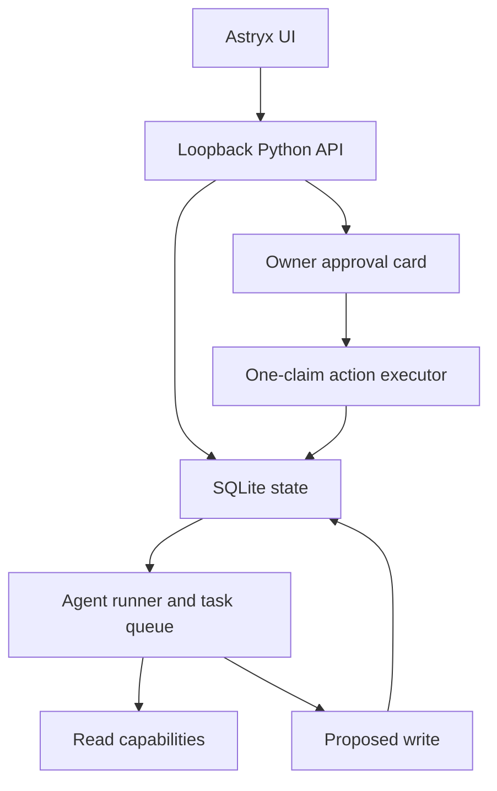

# Current local architecture

The active backend is Python/FastAPI. Agent execution, tools, workflows,
memory, dreams, scheduling and approvals are Python modules; React/Astryx is
the UI. `scripts/python.mjs` only selects and launches the interpreter. Retired
TypeScript code is archived outside the build in `legacy/typescript`.
Cloudflare integration is deferred; the earlier Worker is not deployed by
the current commands.

The current implementation runs on the user's computer. **There is no VM.**
Cloudflare remains a later deployment adapter, not a dependency of local startup.
All language-model requests use GPT-6 Luna, including memory ranking and summaries.

## Ownership

| Concern | Owner |
| --- | --- |
| UI, theme and review forms | `web/src/` |
| HTTP limits, static assets, loopback binding and Host checks | `backend/harness/server.py` |
| Authentication, queue, tool dispatch, resumption and delivery decisions | `backend/harness/runtime.py` |
| Durable transactions, revisions, action digest and recovery | `backend/harness/store.py` |
| Model/tool feedback loop | `backend/harness/agent.py` using OpenAI Agents SDK |
| Dedicated Chromium lifecycle and public-network policy | `backend/harness/browser.py` |
| Google OAuth and encrypted credential vault | `backend/harness/connectors.py` |
| Confined artifacts and optional Docker execution | `backend/harness/workspace.py` |
| Human-readable memory projections | `backend/harness/memory.py` |
| Timezone cron and missed-tick coalescing | `backend/harness/scheduling.py` |
| Full-history search, people graph and repair records | `backend/harness/knowledge.py` |
| Per-source freshness and bounded claim support review | `backend/harness/freshness.py` |
| Additional provider grants and bounded operations | `backend/harness/providers.py` |
| Duplicate/source-observation delivery gate | `backend/harness/proactivity.py` |

## Data boundaries

`.assistant/assistant.sqlite` owns conversation history, memories, revision
lineage, goals, task state, schedules, approvals, inbox, usage and audit events.
The raw transcript, summary, curated memory and current prompt are distinct.
Saved-memory search supports keywords or bounded GPT-6 Luna ranking. A separate
FTS5 index covers every retained message; semantic history search expands queries
and ranks candidates with Luna. It is not a vector embedding index. Sourced
people/group revisions, relationships, repairs and freshness reports share SQLite.

`.assistant/browser-profile` belongs only to the assistant. It never opens the
user's everyday browser data. Cookies persist; tab identities can change when
headless/manual modes restart the browser. Manual control blocks agent browser
operations. Password input is left to the user in the dedicated window.

`.assistant/credentials` is outside the tool workspace. Google tokens use an
AES-GCM encrypted envelope. Status/model/tool APIs do not expose token values.
`.assistant/workspace` contains artifacts, reviewed procedures, and managed
memory files. Relative-path checks and symlink checks confine file operations.

## Execution and authorization

The model proposes tools and consumes actual results. External writes pass
through immutable approvals with an expiry and SHA-256 digest. An owner decision
permits one atomic execution claim. A failed/interrupted write is uncertain
until checked; recording a checked outcome does not execute it again.

Task and schedule state persist separately from SDK inference state. Queue
recovery requeues bounded interrupted runs and holds uncertain writes for review.
Schedule dispatch atomically enqueues its stable occurrence ID and advances the
schedule. Background work continues only while the local server is running.

Subtasks are bounded and read-only; child results are handed back explicitly.
Managed goal-step completion needs a reference to a source or artifact observed
by that task. A human can explicitly update goal state independently.

Token reservations limit admission across runs; final usage is recorded. These
are not exact cost ceilings, and hosted search has additional charges. The
current tool surface is a bounded operation dispatcher; fully lazy SDK schema
loading is not implemented.

## Proactivity and outputs

Explicit reminders can deliver each occurrence. Changes-only research schedules
compare fingerprints, re-read bounded source excerpts and require a per-source
freshness and model-based claim-support review. Unsupported/incomplete reviews
are held with a repair thread. Results and
delivery decisions remain inspectable separately. This checks observations and
freshness; it does not prove every claim. Desktop notifications currently work
only while Inbox is open, not as closed-app push.

Dreams create evidence-backed proposals. Applying reviewed text requires the
captured memory revision. They do not rewrite executable system instructions or
silently authorize new work. Readable memory projections are conveniences; if
refresh fails, stale managed files are blocked while SQLite stays authoritative.

Generated HTML is text/attachment data on the app origin. No host-shell tool is
exposed. Optional script execution requires explicitly enabled Docker and a
preloaded image, with no network and read-only workspace mounts. There is no VM
provisioning or arbitrary persistent Linux process environment.

## Verification boundary

See `VERIFICATION.md` for actual checks. Unit/component tests use model/browser
adapters and mock Google HTTP. Chromium launch, real account consent, full live
model use and Cloudflare deployment are not inferred from passing tests.
