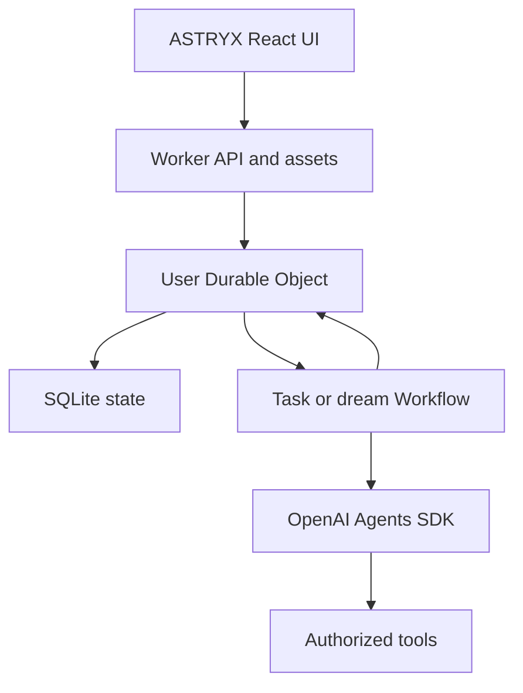

# Architecture

## Responsibilities

OpenAI's Agents SDK owns the bounded model/tool loop. Cloudflare owns request handling and durable execution. The application owns memory semantics, task policy, authorization, scheduling rules, and what the model is allowed to do.

A Durable Object is a logical coordinator, not a continuously running VM. Messages and alarms wake it; persisted state remains available between activations. Use one object per user initially, with a trusted identity boundary at the Worker.

The initial UI shell lives in `web/`. Vite builds static assets into `dist/` for the Worker asset binding. Run the UI build before `wrangler dev`; during UI development, `npm run dev:ui` proxies API requests to Wrangler on port 8787.

## State ownership

| State | Authoritative owner | Notes |
|---|---|---|
| Conversations | User Durable Object SQLite | Preserve source messages independently of summaries |
| Durable memories | User Durable Object SQLite | Evidence, explicit/inferred status, and revision |
| Goals and tasks | User Durable Object SQLite | Explicit states and next actions |
| Schedules | User Durable Object SQLite | Due instant, recurrence, and execution identity |
| Long task progress | Cloudflare Workflow | Checkpoints across durable stages |
| Model run state | SDK plus application checkpoints | Persist what is needed to resume; do not rely on RAM |
| Documents, later | R2 | References in SQLite rather than oversized prompts |
| Semantic index, later | Vectorize | Derived index; not the source of truth |
| Provider credentials | Secret/credential boundary | Never place them in model-visible context |

## Request flow

The Worker validates the bearer service token, selects an assistant namespace, validates payloads, and forwards to the Durable Object. The object loads bounded relevant context and calls the SDK adapter. It saves messages and results with useful event metadata.

The initial gateway always routes to the `personal` namespace and ignores caller-provided user IDs. The shared service token does not provide end-user authentication. A public deployment must replace that trust model with verified login and server-derived user IDs.

Serialize or explicitly coordinate overlapping conversation writes. Durable Object placement alone does not make a multi-await chat transaction atomic. Memory publication uses revisions so a dream cannot silently replace memories updated by a live conversation.

## Context assembly

The application constructs the model-visible input from instructions, relevant memory, current task/goal, a history summary when available, and recent turns. Budget each component and retain references to omitted material for later retrieval.

The initial runtime marks model-extracted memory as inferred. Manually entered memory and user-approved dream text are explicit. The authenticated memories and events endpoints make stored memory and recent audit events inspectable.

SDK application context carries tool dependencies and identity; it is separate from the text/messages supplied to the model. Keep secrets in application dependencies and authorize tool arguments at execution time.

## Scheduling

Schedule creation stores a validated task definition before arming an alarm for the earliest due instant. When awakened, the object identifies due occurrences and dispatches durable work. Recurrence advances according to a documented policy and the next alarm is armed.

Initial scope is UTC one-shot execution and fixed-second intervals. A local daily schedule requires a timezone-aware recurrence calculation: a fixed 24-hour interval is not equivalent across daylight-saving transitions.

Use a stable occurrence ID for Workflow creation. A later notification or external write should reuse a stable operation key rather than generating a new identity on every retry. Persist dispatch state so failures can be reconciled. Set overlap and missed-run policies explicitly before allowing high-frequency schedules.

## Dreams

A dream is an ordinary background Workflow with narrower permissions. It reads a bounded snapshot of new activity and current memory, extracts evidence-backed candidates, deduplicates, checks contradictions, and proposes a revised memory set. Publication checks the input memory revision; conflicts trigger reconciliation rather than blind replacement.

In the initial API, `POST /api/tasks` with `kind: "dream"` starts a proposal. `POST /api/dreams/apply` accepts a completed dream's task ID and user-approved text. It checks the dream's input memory revision before saving that text as explicit memory; it does not automatically replace the entire memory store.

No dream needs permission to send emails or purchase anything. Tool access should be limited to reading approved sources and proposing memory updates. Goal leads and possible reminders remain proposals unless existing user instructions authorize them.

## Durable execution and approvals

Workflow checkpoints wrap meaningful stages, not an unlimited end-to-end agent loop. Persist run inputs and results, bound SDK turns, and prevent retries from duplicating side effects. Workflows improve recovery but do not guarantee exactly-once effects in a third-party system.

When approval tools are added, persist the exact proposed action and its parameters, pause the task, and resume only after checking the approval against that action. Cancellation and expired approvals must be terminal or require a new review, according to explicit transitions.

## Operational boundaries

The foundation should expose useful task state and errors without leaking secrets. Add structured traces, cost accounting, per-user concurrency limits, retention controls, notification delivery, and regression evaluations as autonomy expands. API-based tools fit the initial Worker runtime; shell execution and unrestricted desktop control require a separate execution environment and are outside the MVP.
