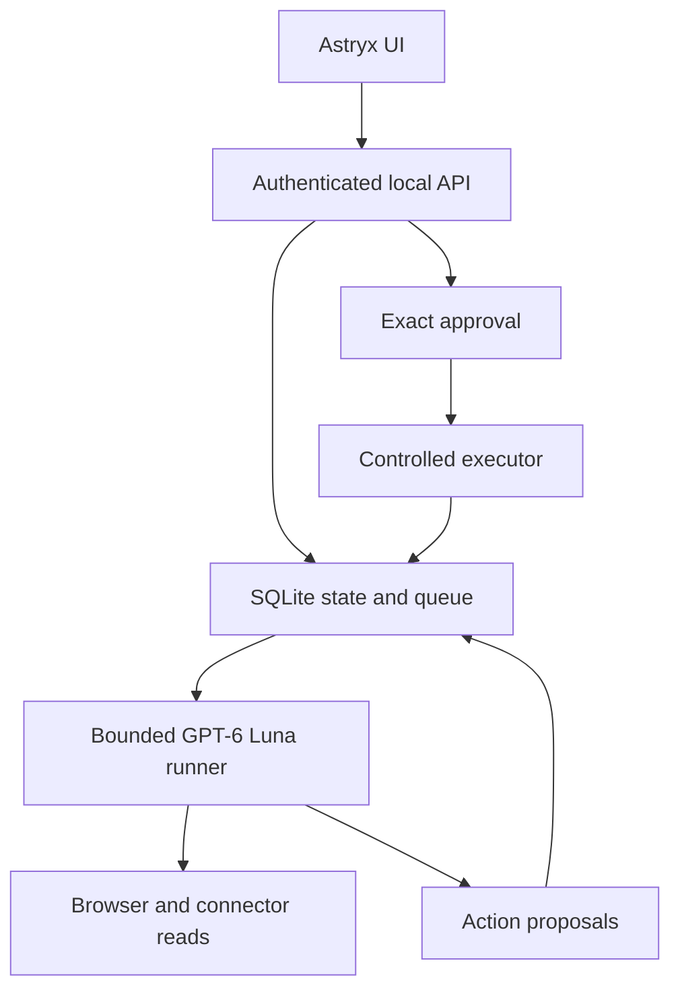

# Personal assistant: ordered implementation plan

Build a local-first assistant with GPT-6 Luna only, Astryx UI, persistent state,
its own Chromium browser, controlled actions and background work. All active
agent behavior runs in Python; the UI remains React/Astryx. Hosted Python and
Cloudflare integration follows local acceptance testing. This is an
independent product inspired by public behavior, not a reproduction of Meta's
private backend or a promise of Muse feature parity.

The dedicated Linux VM is explicitly out of scope at the user's request. Do
not provision one or make it a prerequisite for local operation.

| Order | Deliverable | Acceptance gate |
| --- | --- | --- |
| 1 | Local Python/FastAPI server, disk SQLite, authenticated API, durable task queue and recovery | Start without Cloudflare; history survives restart; interrupted writes are not blindly repeated |
| 2 | Dedicated persistent Chromium profile, tabs, navigation, page snapshots, screenshots, manual login | Open a public page, inspect it in UI, retain dedicated logins across relaunch; never use everyday profile |
| 3 | Immutable action payloads, exact approval cards, expiry, atomic execution claims, audit, usage limits | Unapproved/rejected/expired actions never execute; duplicate approval cannot repeat writes; interrupted actions become uncertain |
| 4 | Typed searchable memory, corrections, version checks, goals/steps, summaries, dream proposals | Corrections win over inference; stale dreams conflict; goal progress and evidence remain inspectable |
| 5 | One-shot, interval and timezone cron; events; bounded subtasks; notifications and resumption | UI can close while server stays running; stable occurrence IDs suppress duplicates; unread results remain in inbox |
| 6 | Google OAuth PKCE, encrypted vault, Gmail search/read/send, Calendar list/create | User authorizes real scopes; reads work; sends/event writes require exact approval; disconnect removes credentials |
| 7 | Confined files/artifacts, reviewed reusable procedures, Docker-only code execution | Reject traversal/symlinks; download real outputs; never execute scripts on host; bound resources/time |
| 8 | Cloudflare browser/executor adapters, hosted deployment, real multiuser auth, push delivery | Repeat local acceptance checks on hosted bindings; isolate tenants and test retention/export |

Workflow orchestration is implemented locally: validated DAGs, parallel
specialists, dependency joins, verifier and synthesis agents, persisted stage
results, bounded retries reusing successful stages, cancellation, and a single
final inbox answer. Chat can create teams; the Workflows UI exposes progress,
results and controls. All stages are read-only GPT-6 Luna runs. Component tests
and frontend build pass. The user also passed the live Python workflow gate:
specialists, verifier and synthesizer consumed dependency results, each ran once,
and one final inbox receipt was recorded. Python local/restart and approval
acceptance checks passed as recorded in `docs/VERIFICATION.md`.

Independent modules may be prepared in parallel. Being implemented is not the
same as being live-tested. Do not claim a stage complete without its gate.

## Runtime design

State, cookies, encrypted OAuth credentials and workspace data live under
`.assistant/` and never enter Git. A local process must remain running for
background work. A sleeping/offline laptop is not an always-on cloud service.

## Rules that must be enforced in code

- Distinguish model proposals, authorization, execution and user receipt.
- Tasks persist queued/running/waiting_approval/completed/failed/cancelled state.
- Bind an approval to immutable arguments, digest and expiry. Claim execution
  once; a crash during an external write becomes uncertain, not an automatic retry.
- Stable schedule occurrence IDs; coalesce missed interval ticks after downtime.
- Separate history, summary, memories and current context. Preserve provenance,
  user corrections and optimistic memory revisions.
- Dreams publish evidence-backed proposals first. Approval applies against the
  input revision; inferred preferences never become authorization.
- Public browsing is available; browser click/fill actions require review.
  No arbitrary JavaScript execution tool. Manual login happens in the separate
  browser. Cookies and credentials are never exposed through API/model context.
- Scripts run only in explicitly enabled Docker containers, with no network,
  confined mounts, resource/time bounds and explicit approval. No host shell tool.
- Reserve and record tokens; limit turns, concurrent runs and child tasks.
  Do not advertise a dollar cap without verified model prices.
- Artifact HTML downloads as attachments, not executable pages on the app origin.

## External prerequisites and deferred capability

Gmail/Calendar need the user's own Google OAuth client and consent. Spotify,
Threads, Instagram, health and device integrations each need supported APIs,
eligible accounts and separate authorization. Interface code does not mean an
account is connected. Image/video/audio generation needs provider-specific
models; using GPT-6 Luna for language does not provide those modalities.

## Research sources

- [Official Muse design](https://muse.ai/blog/how-we-designed-muse): agent
  computer/browser, background goals, editable memory, structured permissions,
  artifacts; product behavior rather than a full backend contract.
- [CodePick guide](https://codepick.dev/en/guides/muse-architecture/): independent
  analysis that explicitly distinguishes observations from unknown internals.
- [Playwright persistent context](https://playwright.dev/docs/api/class-browsertype#browser-type-launch-persistent-context): dedicated user-data directory and lifecycle.
- [OpenAI SDK approvals](https://openai.github.io/openai-agents-js/guides/human-in-the-loop/): interruption/resumption primitives.
- [Google Gmail quickstart](https://developers.google.com/workspace/gmail/api/quickstart/nodejs): API project, scopes and user consent.
- [Cloudflare browser sessions](https://developers.cloudflare.com/browser-run/features/reuse-sessions/): later hosted session management; reuse is not a permanent VM guarantee.

## Verification

Before expansion, TypeScript, frontend build and 19 component tests passed.
Live model/browser/background operation was not verified. Record current
evidence and blockers in `docs/VERIFICATION.md`; clearly label test doubles.
Missing credentials, dependencies, network and process permissions are blockers,
not successful live tests. Deployment remains deferred until local validation.

## Additional target capabilities from Muse's self-description

Treat these as product requirements to evaluate, not independently verified
facts about Muse's internal implementation.

| Requirement | Current implementation or next work |
| --- | --- |
| Claim lineage | Implemented version chain, source IDs, provenance and confidence; source claims still need human/provider verification |
| Human-readable layers | Managed curated/daily/person files; not a complete relationship graph |
| Semantic retrieval | GPT-6 Luna ranking over bounded saved memories; all-transcript semantic indexing remains open |
| Alignment dreams | Read-only synthesis proposals and reviewed revision-safe application; no automatic rewritten system prompt |
| Proactive delivery | Explicit every-run reminders vs changes-only research gate, source-observation freshness, recorded skip decisions; full claim re-verification and push remain open |
| Deferred namespaces | A bounded operation dispatcher exists; true on-demand SDK schema loading remains open |
| Side chats and messaging | Not implemented; require separate thread state and provider-specific messaging authorization |
| Rich documents/media | Text/web artifacts exist; PDF/Office generators and media providers remain open |
| Commerce and phones | Not implemented; provider/payment/device setup and stronger per-action review would be required |

The user has now passed live browser navigation/snapshot/screenshot, GPT-6 Luna
connectivity, memory-search chat, scheduled execution/inbox delivery, restart
persistence and browser approval/rejection/digest/replay smoke tests. See
`docs/VERIFICATION.md` for the evidence and scope. Remaining local gates include
visible/manual browser control, retained dedicated logins, memory/dream UI
review, real Google OAuth consent and optional Docker execution. These remain
open before hosted deployment; no OAuth or account-write success is claimed.
